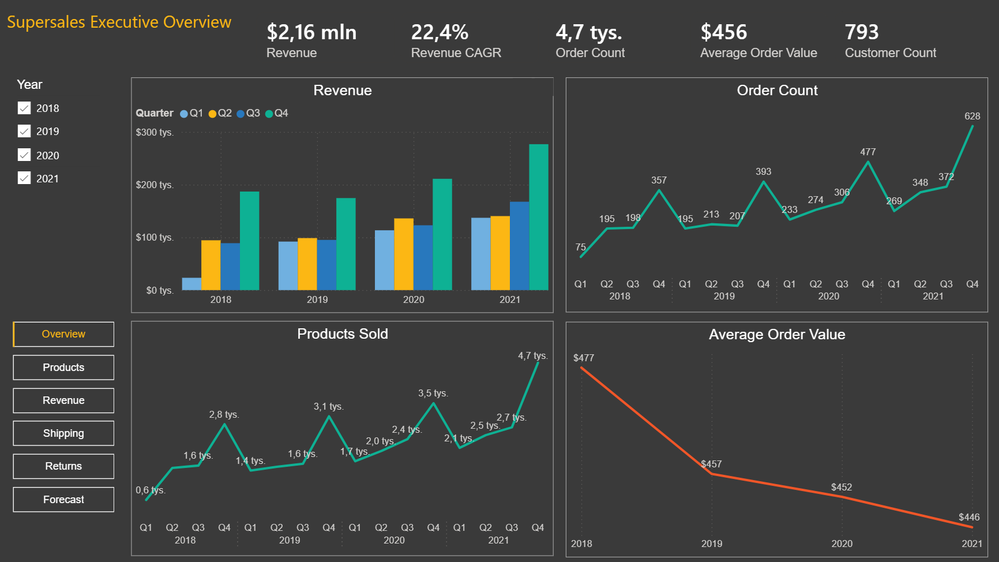
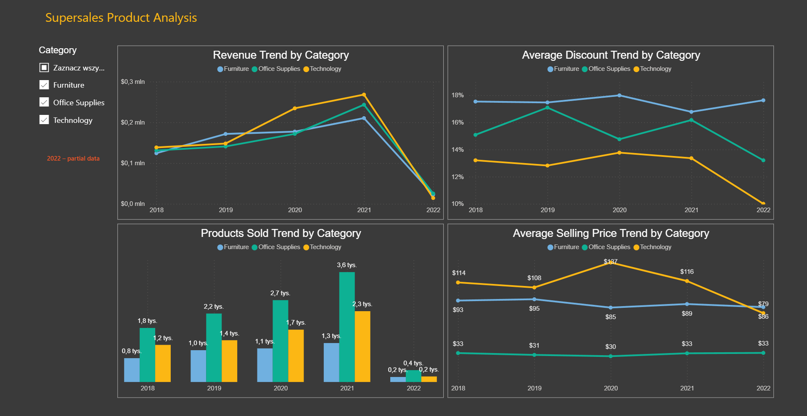
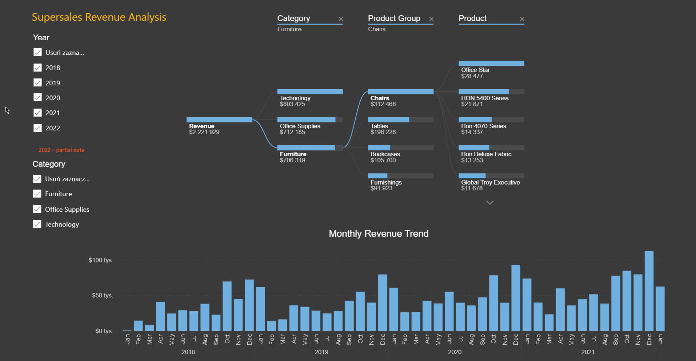
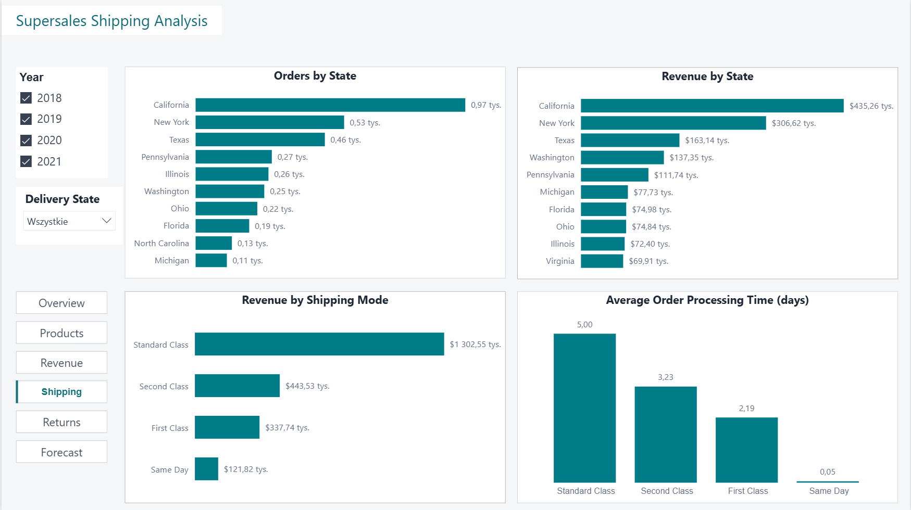
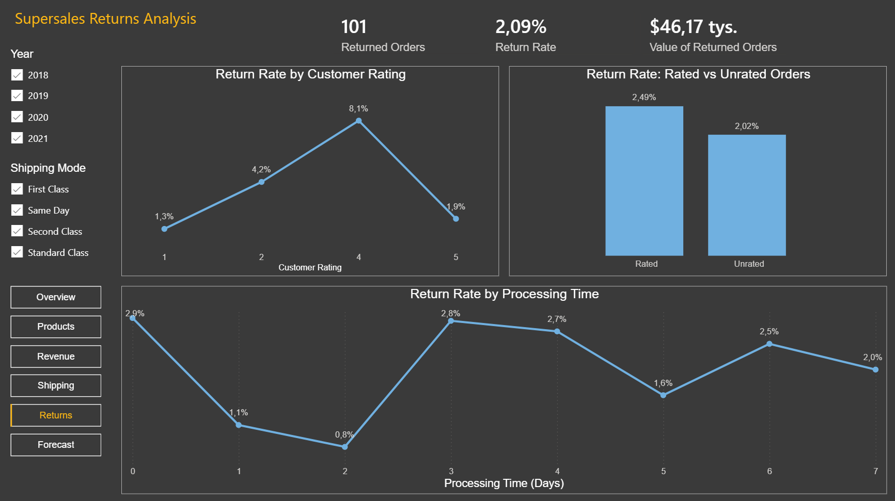
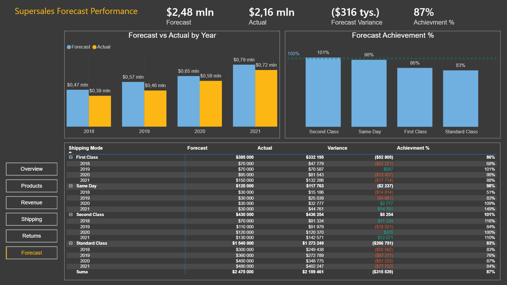
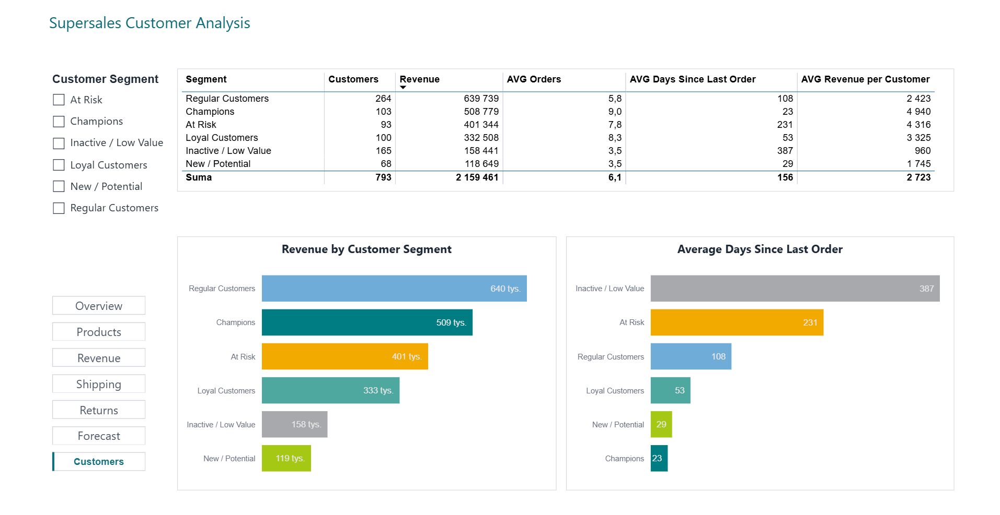

# Supersales – SQL & Power BI Analysis

Supersales is a data analytics portfolio project developed as part of my training with KajoData.

The project combines **MySQL, SQL, Power BI, Power Query and DAX** to analyse sales performance, products, shipping, returns, forecast performance and customer behaviour.

The original CSV data was imported into MySQL and organised into a relational schema. Selected transformations and customer segmentation are performed in SQL, while Power BI provides the semantic model, DAX calculations and interactive reporting.

## Live Report

[View the interactive Power BI report](https://app.powerbi.com/view?r=eyJrIjoiYjVlNjgwMGQtYWIzYS00YTQ1LThmMzEtOWE3ODE3MGRkNzc0IiwidCI6IjVhZmVlYTZlLTRhYTItNGU4OC1iY2UyLWIyMzA4N2VjZDRlYSJ9&pageName=0e9dd8108441ba3ebe72)

## Report Overview



The report contains seven analytical pages:

- Executive Overview
- Product Analysis
- Revenue Analysis
- Shipping Analysis
- Returns Analysis
- Forecast Performance
- Customer Analysis

Custom report page tooltips provide additional context without leaving the current report page.

## Key Insights

### Sales Performance

- Total analysed revenue for 2018–2021 was approximately **$2.16M**.
- Revenue CAGR was approximately **22.4%**.
- Revenue growth was accompanied by increasing order and product volume, while **Average Order Value declined from $477 in 2018 to $446 in 2021**.
- This indicates that growth was primarily **volume-driven rather than driven by increasing order value**.
- Sales show a recurring seasonal pattern, with stronger performance toward the end of the year.

### Products

- **Technology** was the strongest revenue-generating category at approximately **$789K**.
- **Office Supplies** generated the highest unit volume despite having the lowest Average Selling Price.
- Technology combined the highest Average Selling Price with relatively low discount levels.
- **Furniture received the highest average discounts**, but this did not translate into superior revenue performance.
- The available data does not contain margin information, so the impact of discounts on profitability cannot be determined.

### Shipping and Returns

- **California** was the largest market in both order volume and revenue.
- **Standard Class** generated approximately **$1.30M in revenue** and had the longest average processing time at approximately **5 days**.
- **101 orders were recorded as returned**, resulting in a **2.09% Return Rate** for the analysed period.
- The value associated with returned orders was approximately **$46.17K**, but this should not be interpreted as a confirmed refund amount.
- The available data does not show a clear relationship between customer ratings, processing time and the probability of return.

### Forecast Performance

- Forecast for 2018–2021 was approximately **$2.48M**, compared with actual revenue of approximately **$2.16M**.
- Overall **Forecast Achievement was approximately 87%**, with a negative variance of approximately **$316K**.
- Around **85% of the total negative variance** was concentrated in Standard Class.
- Standard Class remained below forecast in every analysed year.

### Customer Analysis

Customers were segmented using an **RFM model (Recency, Frequency, Monetary)** calculated in SQL.

- **Regular Customers** were the largest segment with **264 customers** and approximately **$640K in revenue**.
- **Champions** represented 103 customers and generated approximately **$509K**.
- Champions had the highest average order frequency and the highest average revenue per customer at approximately **$4.9K**.
- **Inactive / Low Value** customers had the longest average time since their last order at approximately **387 days**.
- **At Risk** customers averaged approximately **231 days since their last order**, while still generating relatively high revenue per customer.

The segmentation is descriptive and intended to support customer analysis and prioritisation rather than predict future customer behaviour.

## Data Architecture

The project evolved from a CSV-based Power BI report into a database-backed analytical solution:

```text
CSV source files
       │
       ▼
MySQL source tables
       │
       ▼
SQL preparation layer
       │
       ▼
Power BI semantic model
       │
       ▼
DAX measures
       │
       ▼
Interactive report
```

The MySQL database contains separate tables for:

- customers
- orders
- order positions
- products
- product groups
- ratings
- returns
- forecast data

Primary and foreign keys are used to preserve the relationships and granularity of the source data.

### SQL Preparation Layer

Most source tables are loaded directly from MySQL into Power BI. Transformations that are more appropriate at source level are handled through SQL views.

`vw_products`

- creates the shortened product name used in report visuals.

`vw_orders`

- creates the delivery location,
- calculates order processing time,
- identifies rated and unrated orders,
- creates processing-time labels used in the report.

`vw_customer_rfm`

- aggregates customer activity,
- calculates Recency, Frequency and Monetary values,
- assigns RFM scores using `NTILE()` window functions,
- classifies customers into business segments.

Power Query is used mainly for connecting Power BI to MySQL, selecting the required fields and assigning appropriate data types.

## Analytical Approach

### Revenue

Revenue is calculated at order-position level:

`Revenue = Quantity × Product Price × (1 - Discount)`

DAX uses `SUMX` to iterate through order positions and `RELATED` to retrieve product prices.

Orders recorded as returned are excluded from the main Revenue measure.

### Analysis Period

The source data covers **January 29, 2018 to January 25, 2022**.

The report focuses on **2018–2021** because 2022 contains only 25 days of data and would create misleading annual and quarterly comparisons.

The beginning of 2018 is also partial and is retained as the start of the observed dataset.

### RFM Customer Segmentation

RFM segmentation is calculated in MySQL using:

- **Recency** – days since the customer's last order
- **Frequency** – number of distinct orders
- **Monetary** – revenue generated by the customer, excluding returned orders

Customers receive scores from 1 to 5 using SQL `NTILE()` window functions.

The scores are used to create six customer segments:

- Champions
- Loyal Customers
- At Risk
- New / Potential
- Inactive / Low Value
- Regular Customers

The resulting SQL view is loaded into Power BI for segment-level analysis and visualisation.

### Forecast

The `cost_forecast` table contains forecast values for 2018–2021 by shipping mode.

Because the exact business definition of `cost_forecast` is not documented, I treat it as a **budget-like financial benchmark** rather than confirmed shipping cost.

The main calculations are:

`Forecast Variance = Actual - Forecast`

`Forecast Achievement % = Actual / Forecast`

This interpretation is an analytical assumption and would require confirmation from the data owner in a real business environment.

## Report Pages

### Product Analysis



Analysis of revenue, products sold, average discount and average selling price across product categories.

### Revenue Analysis



Revenue trends and an interactive decomposition tree allowing analysis from **Category → Product Group → Product**.

### Shipping Analysis



Analysis of order volume and revenue by state and shipping mode, together with average order processing time.

### Returns Analysis



Analysis of return rates by customer rating and processing time, including rated versus unrated orders.

### Forecast Performance



Comparison of forecast and actual revenue by year and shipping mode, including variance and achievement percentage.

### Customer Analysis



RFM-based customer segmentation comparing customer count, revenue, average order frequency, recency and average revenue per customer.

Interactive report-page tooltips explain the RFM methodology and individual segment rules.

## Data Limitations

The analysis should be interpreted with several limitations in mind:

1. **Data coverage** – 2022 contains only 25 days and is excluded from the main analysis. The beginning of 2018 is also partial.
2. **Historical prices** – product prices come from the product catalogue rather than transaction-level historical prices.
3. **Ratings** – customer ratings are available only for a subset of orders.
4. **Returns** – returns are recorded at order level and do not identify specific returned products, quantities or confirmed refund amounts.
5. **Forecast definition** – the exact business meaning of `cost_forecast` is not documented.
6. **RFM segmentation** – segments are based on relative scoring and defined analytical rules rather than externally validated customer classifications.

## Tools and Skills

- MySQL
- SQL
- SQL Views
- CTEs
- Window Functions
- Power BI
- Power Query
- DAX
- Relational Data Modeling
- RFM Customer Segmentation
- Data Visualization
- KPI Design
- Variance Analysis

## Repository Structure

```text
supersales-power-bi-analysis/
│
├── sql/
│   ├── 01_create_tables.sql
│   └── 02_power_bi_views.sql
│
├── dax/
├── documentation/
├── images/
│   ├── executive-overview.png
│   ├── product-analysis.png
│   ├── revenue-analysis.png
│   ├── shipping-analysis.png
│   ├── returns-analysis.png
│   ├── forecast-performance.png
│   └── customer-analysis.png
│
└── README.md
```

## Project Summary

This project demonstrates the development of a small end-to-end analytical solution:

**CSV → MySQL → SQL → Power BI → DAX → interactive analysis**

It gave me practical experience in relational data modeling, SQL views, CTEs and window functions, source-level data transformation, RFM customer segmentation, DAX measures and business-oriented data analysis.

A key part of the project was not only calculating KPIs, but also understanding data granularity, documenting assumptions and distinguishing analytical findings from conclusions that the available data cannot support.
