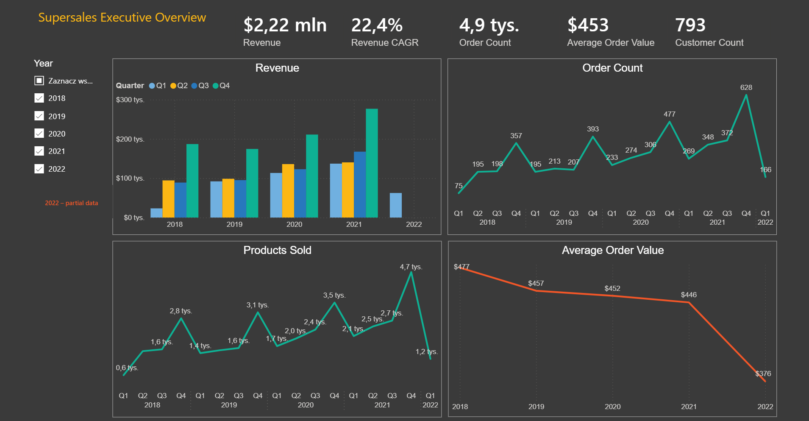
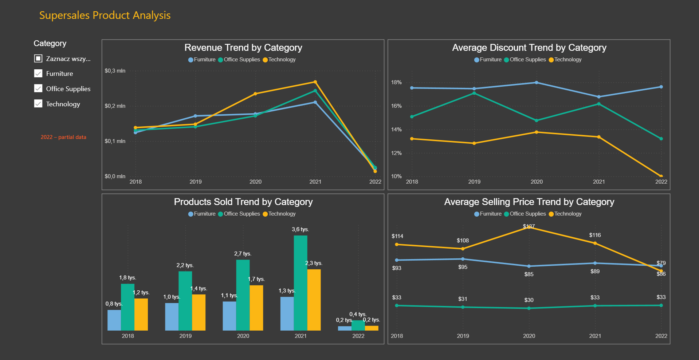
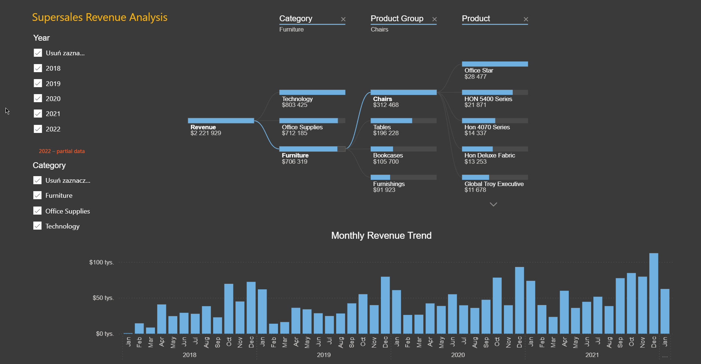
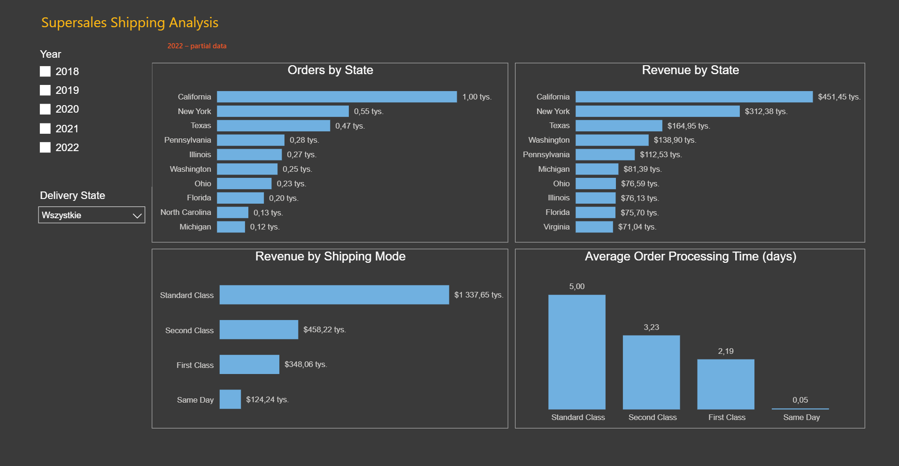
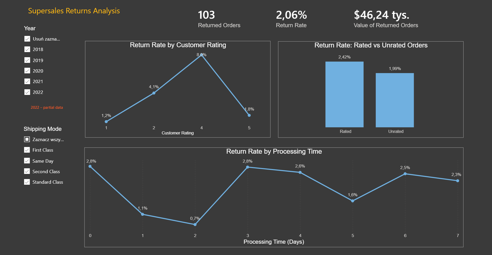
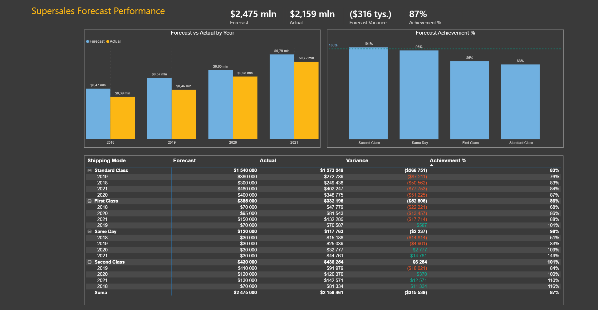

# Supersales – Power BI Analysis

Supersales is a Power BI portfolio project I developed as part of my data analytics training with KajoData.

The report explores sales performance from several perspectives: revenue, products, shipping, returns and forecast performance. My focus was on preparing the source data, building a relational data model, creating DAX measures and understanding the limitations of the available data.

## Live Report

[View the interactive Power BI report](https://app.powerbi.com/view?r=eyJrIjoiYjVlNjgwMGQtYWIzYS00YTQ1LThmMzEtOWE3ODE3MGRkNzc0IiwidCI6IjVhZmVlYTZlLTRhYTItNGU4OC1iY2UyLWIyMzA4N2VjZDRlYSJ9&pageName=0e9dd8108441ba3ebe72)

## Report Overview



The report consists of six pages:

- Executive Overview
- Product Analysis
- Revenue Analysis
- Shipping Analysis
- Returns Analysis
- Forecast Performance

Each page focuses on a different aspect of the sales process, from overall performance and product categories to order processing, customer ratings and returns.

## Dataset and Data Preparation

The project uses the Supersales dataset provided as part of the KajoData training materials.

The source data consists of eight CSV files:

- `orders.csv`
- `order_positions.csv`
- `customers.csv`
- `products.csv`
- `product_groups.csv`
- `order_ratings.csv`
- `order_returns.csv`
- `cost_forecast.csv`

I used Power Query to prepare the source files, correct data types and resolve data formatting issues, including decimal separators.

I then worked with a relational data model in Power BI to analyze data across orders, order positions, customers, products, ratings and returns.

An important part of the project was understanding the granularity of each table. Order positions represent individual products within an order, while ratings and returns are recorded at order level.

## Analytical Approach

### Revenue Calculation

Revenue is not stored directly in the order positions table.

I calculated it using product price, quantity and discount:

`Revenue = Quantity × Product Price × (1 - Discount)`

The DAX measure uses `SUMX` to calculate revenue for individual order positions and `RELATED` to retrieve prices from the products table.

One limitation is that product prices come from the product catalog rather than being stored separately at the time of each transaction. Therefore, the calculated historical revenue depends on the available catalog prices.

### Time Analysis and Partial Data

The dataset covers 2018–2022, but 2022 contains only partial data.

Comparing an incomplete year directly with full previous years could lead to misleading conclusions.

To make this limitation visible, I created a DAX measure that displays a `2022 – partial data` notice whenever 2022 is included in the current filter context.

I also took incomplete periods into account when calculating Revenue CAGR.

### Product Analysis

The product analysis focuses on four main measures:

- Revenue
- Products Sold
- Average Discount
- Average Selling Price

These measures help compare product categories in terms of sales value, volume, discount levels and average realized selling price.

### Shipping Analysis

The shipping analysis compares order volume and revenue across delivery states and shipping modes.

I also calculated average order processing time using the difference between order date and shipping date.

This allows processing times to be compared across shipping modes.

### Returns Analysis

Returns are recorded at order level rather than individual product level.

The dataset identifies orders with a recorded return, but it does not specify which products were returned, their quantities or whether the entire order was refunded.

For this reason, the report does not assume that the full value of a returned order represents an actual refund.

The analysis includes:

- Returned Orders
- Return Rate
- Value of Returned Orders
- Return Rate by Customer Rating
- Return Rate: Rated vs Unrated Orders
- Return Rate by Processing Time

The KPI named `Value of Returned Orders` represents the calculated revenue associated with orders that have a recorded return. It should not be interpreted as a confirmed refund amount.

Customer ratings are available only for a subset of orders. Missing ratings are treated as missing information rather than a rating of zero.

The relationships between ratings, processing time and returns are descriptive and do not establish causation.

### Forecast Analysis and Business Assumption

The `cost_forecast` table contains forecast values for 2018–2021, broken down by shipping mode.

Although the source column is named `cost_forecast`, I decided to treat these values as a budget-like financial benchmark rather than literal shipping costs.

This decision was based on the scale of the figures:

- Total forecast: approximately $2.48 million
- Actual revenue for the comparable period: approximately $2.16 million

The forecast values are comparable in magnitude to total sales revenue. This raised doubts about interpreting them as shipping costs alone.

For the purpose of this analysis, I therefore compared the forecast values with actual revenue and used the neutral label **Forecast** in the report.

The analysis includes:

- Forecast
- Actual
- Forecast Variance
- Forecast Achievement %

The calculations are:

`Forecast Variance = Actual - Forecast`

`Forecast Achievement % = Actual / Forecast`

The comparison covers 2018–2021 because forecast values are not available for 2022.

**Important:** Treating `cost_forecast` as a budget-like benchmark is my analytical assumption, not a confirmed business definition. The available documentation does not clearly establish whether these values represent a sales budget, another financial forecast or a different cost category.

The forecast-versus-actual results should be interpreted with this limitation in mind.

## Selected DAX Measures

The report includes measures such as:

- Revenue
- Orders Count
- Products Sold
- Customers Count
- Average Order Value
- Average Selling Price
- Average Discount
- Revenue CAGR
- Returned Orders
- Return Rate
- Average Order Processing Time
- Forecast Variance
- Forecast Achievement %

I used DAX iterator functions such as `SUMX` and `AVERAGEX`, along with functions including `CALCULATE`, `DIVIDE`, `ALL`, `ALLSELECTED` and `REMOVEFILTERS`.

An important part of the work was understanding filter context and ensuring that measures produced meaningful results across different report selections.

## Report Pages

### Product Analysis



Analysis of revenue, products sold, average discount and average selling price across product categories.

### Revenue Analysis



Revenue analysis using a decomposition tree and monthly revenue trend.

The decomposition tree allows exploration from product category through product group down to individual products.

### Shipping Analysis



Comparison of orders and revenue by state, revenue by shipping mode and average order processing time.

### Returns Analysis



Analysis of return rates by customer rating and order processing time, including a comparison between rated and unrated orders.

### Forecast Performance



Comparison of forecast and actual revenue by year and shipping mode, including variance and achievement percentage.

The results are based on the documented assumption about the meaning of the `cost_forecast` values.

## Data Limitations and Assumptions

Several characteristics of the dataset affected the analytical approach:

1. **Partial year:** 2022 contains incomplete data and should not be compared directly with full years.
2. **Historical prices:** Product prices are retrieved from the product catalog rather than stored at transaction level.
3. **Missing ratings:** Only a subset of orders has a recorded customer rating. Rated orders may not be representative of all orders.
4. **Order-level returns:** Return records do not identify returned products, quantities or confirmed refund amounts.
5. **Forecast coverage:** Forecast data is available only for 2018–2021.
6. **Forecast interpretation:** The business meaning of `cost_forecast` is not clearly documented. I treated it as a budget-like benchmark because its magnitude appears inconsistent with shipping costs alone. This assumption would require confirmation from the data owner.

These limitations were considered when defining measures and interpreting the results.

## Tools and Skills

- Power BI Desktop
- Power Query
- DAX
- Relational Data Modeling
- Data Visualization
- KPI Design
- Variance Analysis

## Repository Structure

```text
supersales-power-bi-analysis/
│
├── images/          # Report screenshots
├── dax/             # Selected DAX measures
├── documentation/   # Additional project documentation
└── README.md
```

## Project Summary

This project gave me practical experience in preparing data, working with a relational Power BI model and developing DAX measures.

It also showed me the importance of understanding data granularity, documenting assumptions and distinguishing calculated results from confirmed business facts.
