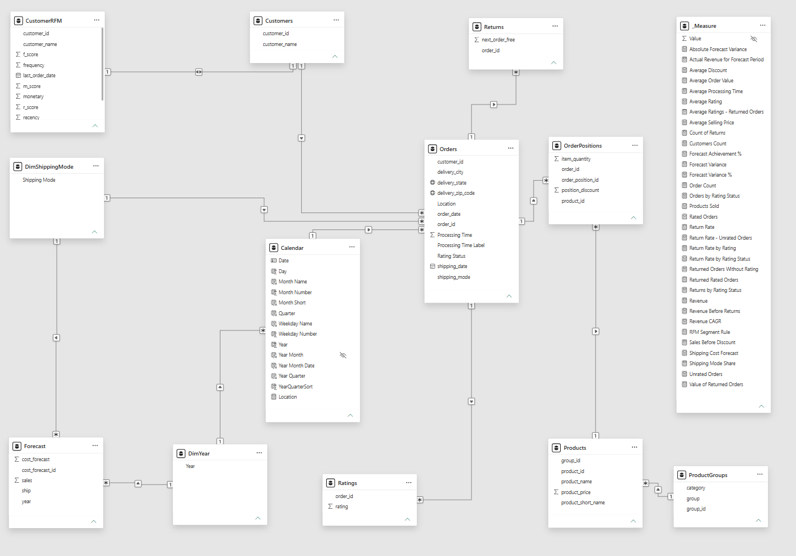

# Supersales – Data Model

## Model Overview

The Power BI model combines sales transactions with customer, product, rating, return and forecast data.

The original CSV files were imported into MySQL. Most tables are loaded directly from MySQL into Power BI, while two views handle transformations that were moved from Power BI to SQL:

- `vw_products` creates the shortened product name used in the report.
- `vw_orders` adds location, processing time, rating status and the processing-time label.

Power Query is still used for the connection, column selection and data types.

## Relationships

The main sales structure is:

`Customers → Orders → OrderPositions → Products → ProductGroups`

Ratings and Returns are connected to Orders because both are recorded at order level.

The Calendar table is connected to Orders through the order date.

Forecast data has a different grain from the sales data, so `DimYear` and `DimShippingMode` are used as shared dimensions. This allows forecast and actual results to be compared by year and shipping mode.

The `_Measure` table is used only to keep DAX measures in one place.

## Data Granularity

The model contains data at several levels:

- `Orders` – one row per order
- `OrderPositions` – one row per product position within an order
- `Products` – one row per product
- `Customers` – one row per customer
- `Ratings` – ratings recorded at order level
- `Returns` – returns recorded at order level
- `Forecast` – one row for a year and shipping mode combination

This distinction is important because measures such as revenue are calculated from order positions, while ratings and returns apply to the whole order.

## Notes and Limitations

Revenue is calculated from quantity, product catalog price and discount. Product prices are not stored separately for each historical transaction, so the calculation relies on the available catalog price.

Returns are recorded only at order level. The data does not identify which products or quantities were returned and does not contain confirmed refund amounts.

Ratings are available only for a subset of orders. Missing ratings are treated as missing information, not as a rating of zero.

Forecast values are available for 2018–2021. The meaning of the `cost_forecast` field is not documented clearly enough to confirm that it represents shipping costs. In the report I treat it as a budget-like benchmark because its scale is comparable to sales revenue. This remains an analytical assumption.

The source contains transactions from January 29, 2018 to January 25, 2022. The report uses data through December 31, 2021 because 2022 contains only a partial month. The 2022 records remain in the source data.
