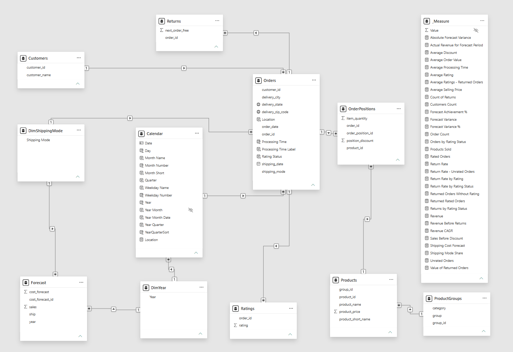

# Supersales – Data Model

## Model Overview

The Power BI model combines sales transactions, product information, customer data, ratings, returns and forecast data.

It contains 12 tables, including a dedicated measure table and additional dimensions created for reporting.

## Tables

| Table           | Purpose                                                     |
| --------------- | ----------------------------------------------------------- |
| Customers       | Customer information                                        |
| Orders          | Order details, dates, shipping and delivery information     |
| OrderPositions  | Individual product positions within orders                  |
| Products        | Product information and catalog prices                      |
| ProductGroups   | Product groups and categories                               |
| Ratings         | Customer ratings recorded at order level                    |
| Returns         | Return records associated with orders                       |
| Forecast        | Forecast values by year and shipping mode                   |
| Calendar        | Date dimension used for time analysis                       |
| DimYear         | Year dimension connecting calendar and forecast data        |
| DimShippingMode | Shipping mode dimension connecting orders and forecast data |
| \_Measure       | Dedicated table for DAX measures                            |

## Relationships

The model uses relationships between transaction tables and their corresponding dimensions.

The main sales structure is:

`Customers → Orders → OrderPositions → Products → ProductGroups`

Ratings and returns are connected to Orders.

The Calendar table is connected to Orders through order dates.

Forecast data is connected to the reporting model through two shared dimensions:

- DimYear
- DimShippingMode

These dimensions allow forecast values and actual sales to be compared by year and shipping mode.

## Data Granularity

The tables contain data at different levels of detail:

- Orders: order level
- OrderPositions: order-position level
- Products: product level
- Customers: customer level
- Ratings: order-rating records
- Returns: order-return records
- Forecast: year and shipping mode

Understanding these differences is important when defining DAX measures and avoiding incorrect aggregations.

## Analytical Considerations

### Revenue

Revenue is calculated from order positions using quantity, product catalog price and discount.

Product prices are not stored separately for each historical transaction.

### Returns

Returns are recorded at order level. The data does not identify individual returned products, quantities or confirmed refund amounts.

### Ratings

Ratings are available only for a subset of orders. Missing ratings are not interpreted as zero ratings.

### Forecast

Forecast values are available for 2018–2021.

The `cost_forecast` field is interpreted as a budget-like financial benchmark rather than literal shipping costs. This is an analytical assumption based on the magnitude of the values, not a confirmed business definition.

### Time Analysis

The source dataset contains transactions from January 29, 2018 to January 25, 2022.

The report focuses on the analytical period from January 29, 2018 to December 31, 2021. The partial 2022 period was intentionally excluded from the report analysis to avoid misleading comparisons with substantially longer annual and quarterly periods.

The underlying 2022 source data is retained in the data model.
